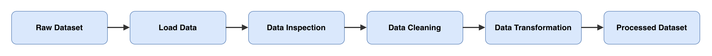

# Pipeline Data Mobil

Project ini membersihkan data mobil yang masih berantakan, lalu menyimpannya sebagai file baru yang siap dipakai.



## Tentang Dataset

- **Isi:** data spesifikasi dan harga mobil. Satu baris berisi satu mobil.
- **Sumber:** `Dataset_Sesi_3.zip` dari mentor AI Engineering Bootcamp.
- **File yang diolah:** `automobileEDA_dirty_training.csv`

## Struktur Folder

```text
data-pipeline-assignment/
├── data/
│   ├── raw/
│   │   └── automobileEDA_dirty_training.csv   (data mentah)
│   └── processed/
│       └── automobileEDA_processed.csv        (data hasil)
├── src/
│   └── pipeline.py                            (kode)
├── documentation/
│   └── data-flow-diagram.png                  (diagram)
├── README.md
└── requirements.txt
```

## Cara Menjalankan

1. Install library yang dibutuhkan:

```bash
pip install -r requirements.txt
```

2. Jalankan pipeline:

```bash
python src/pipeline.py
```

Hasilnya tersimpan di `data/processed/automobileEDA_processed.csv`. Data mentah tidak berubah.

## Alur ETL

| Tahap | Artinya | Yang dilakukan |
|---|---|---|
| Extract | Mengambil data | Membaca file CSV mentah |
| Transform | Mengolah data | Memeriksa, membersihkan, dan mengubah data |
| Load | Menyimpan data | Menyimpan hasil sebagai file CSV baru |

## Kondisi Awal Data

Data awal berisi **205 baris dan 30 kolom**. Masalah yang ditemukan:

| Masalah | Kolom | Contoh |
|---|---|---|
| Data kosong (17 sel) | `stroke` 4, `horsepower` 3, `price` 3, `transaction_date` 2, `make` 2, `num-of-doors` 2, `horsepower-binned` 1 | Harga tidak terisi |
| Baris duplikat (4 baris) | Semua kolom | Baris yang sama muncul dua kali |
| Penulisan tidak seragam | `make`, `body-style`, `drive-wheels`, `fuel-system` | `sedan`, `SEDAN`, `Sedan` |
| Tipe data belum sesuai | `transaction_date` | Tanggal masih berupa teks |
| Format tanggal berbeda | `transaction_date` | `2025-01-05`, `02/01/2025`, `01-03-2025`, `04-Jan-2025` |
| Skala angka berbeda jauh | `price`, `horsepower` | Harga sampai 45.400, tenaga mesin sampai 262 |
| Kategori masih berupa teks | `body-style` | `sedan`, `wagon` |

Tidak ditemukan nilai yang tidak wajar, misalnya harga negatif.

## Data Cleaning

| Yang dibersihkan | Kolom | Caranya | Alasannya |
|---|---|---|---|
| Penulisan tidak seragam | `make`, `body-style`, `drive-wheels`, `fuel-system` | Hapus spasi berlebih dan jadikan huruf kecil | Agar `Sedan` dan `sedan` dihitung sama |
| Tanggal | `transaction_date` | Ubah ke tipe tanggal dengan format `YYYY-MM-DD` | Agar semua tanggal seragam |
| Baris duplikat | Semua kolom | Hapus | Agar data tidak terhitung dua kali |
| Merek kosong | `make` | Isi `unknown` | Merek tidak bisa ditebak |
| Jumlah pintu kosong | `num-of-doors` | Isi `four` | Nilai ini paling sering muncul |
| Kategori tenaga kosong | `horsepower-binned` | Isi `High` | Tenaga mesin mobil ini 262, termasuk paling tinggi |
| Angka kosong | `stroke`, `horsepower`, `price` | Isi median (nilai tengah) | Median tidak mudah terpengaruh nilai yang sangat besar |
| Tanggal kosong | `transaction_date` | Dibiarkan kosong | Tanggal aslinya tidak bisa diketahui |

### Sebelum dan Sesudah Cleaning

| | Sebelum | Sesudah |
|---|---:|---:|
| Jumlah baris | 205 | 201 |
| Data kosong | 17 | 2 |
| Baris duplikat | 4 | 0 |

Dua data kosong yang tersisa adalah tanggal yang sengaja dibiarkan kosong.

### Keterbatasan

- Nilai yang diisi hanya perkiraan. Contohnya, satu harga diisi 10.270, padahal aslinya 14.869.
- Satu mobil punya `horsepower` 95 setelah diisi median, padahal kategorinya `Medium` (biasanya mulai dari 102).
- Saat dibandingkan dengan dataset original, 8 nilai kategori masih salah. Contohnya, merek `honda` tertulis `Audi`. Nilainya terlihat wajar, jadi tidak bisa dideteksi dari data ini saja.

## Data Transformation

Kolom asli tetap disimpan agar mudah dibandingkan dengan kolom barunya.

| Kolom | Metode | Kolom baru | Alasan |
|---|---|---|---|
| `price`, `horsepower` | Min-Max Scaling | `price_scaled`, `horsepower_scaled` | Skalanya berbeda jauh, jadi disamakan menjadi 0 sampai 1 |
| `body-style` | One-hot encoding | 5 kolom `body-style_...` | Komputer lebih mudah mengolah angka daripada teks |

### Contoh Min-Max Scaling

Rumusnya: `(nilai - terkecil) / (terbesar - terkecil)`

| `price` | `price_scaled` | `horsepower` | `horsepower_scaled` |
|---:|---:|---:|---:|
| 13.495 | 0,208 | 111 | 0,294 |
| 16.500 | 0,283 | 154 | 0,495 |
| 13.950 | 0,219 | 102 | 0,252 |

### Contoh One-Hot Encoding

Setiap kategori menjadi satu kolom. Isinya 1 jika sesuai dan 0 jika tidak.

| `body-style` | `convertible` | `hardtop` | `hatchback` | `sedan` | `wagon` |
|---|---:|---:|---:|---:|---:|
| convertible | 1 | 0 | 0 | 0 | 0 |
| hatchback | 0 | 0 | 1 | 0 | 0 |
| sedan | 0 | 0 | 0 | 1 | 0 |
| wagon | 0 | 0 | 0 | 0 | 1 |

## Hasil Akhir

| | Data mentah | Data hasil |
|---|---:|---:|
| Jumlah baris | 205 | 201 |
| Jumlah kolom | 30 | 37 |

**Lokasi hasil:** `data/processed/automobileEDA_processed.csv`
